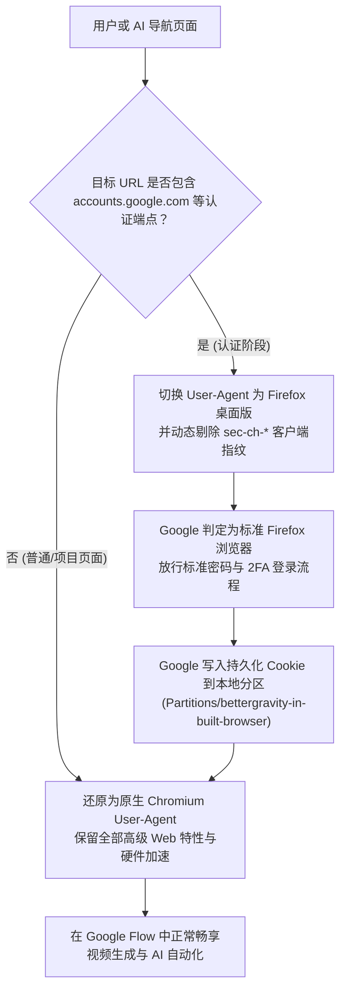

# 内置浏览器 Google 登录与账号适配方案说明

本文档记录了为解决 **Google 官方拦截嵌入式浏览器（Embedded WebView）登录**（提示“此浏览器或应用可能不安全，无法登录”），向 BetterGravity 运行时注入的 **自适应 User-Agent 与请求头双层伪装机制**。

---

## 一、问题背景与排查

1. **初始现象**：
   在 Antigravity 内置浏览器中访问 Google 登录页面（如使用 Google Flow、Google Labs、YouTube 或第三方 Google OAuth 登录）时，Google 风控安全机制会检测运行环境，抛出安全拦截阻断：
   > *“无法登录。此浏览器或应用可能不安全。请尝试使用其他浏览器...”*
2. **Chromium URL 匹配规范注意点**：
   在 Electron / Chromium 的 `webRequest` 接口中，URL Pattern 严禁在域名后缀位置使用通配符（例如 `*://accounts.google.*/*` 属于非法 Match Pattern，会导致 Electron 抛出异常使得浏览器初始化中断，出现 `In Built Browser is disabled` 报错）。
   因此必须使用标准通配符 `<all_urls>`，在请求回调内部通过正则 `/(?:accounts|myaccount)\.google\.|oauth2\.googleapis\.com|accounts\.youtube\.com/i` 进行安全匹配。

---

## 二、双层自适应补丁实现原理

为了在不破坏 Chromium 原生渲染性能（硬件加速、WebGL/WebGPU、视频解码）的前提下无缝通过 Google 安全验证，采用了**“仅在认证阶段伪装为 Firefox，登录完成后即刻还原 Chromium”**的双层自适应策略：

### 1. 网络层拦截（`webRequest.onBeforeSendHeaders`）
* **过滤规则**：采用标准通配符 `urls: ["<all_urls>"]`。
* **处理逻辑**：
  * 判断 `u && /(?:accounts|myaccount)\.google\.|oauth2\.googleapis\.com|accounts\.youtube\.com/i.test(u)`；
  * 若匹配，则清除请求头中所有可能泄露 Chromium 嵌入式特性的 Client Hints（`sec-ch-ua`, `sec-ch-ua-mobile`, `sec-ch-ua-platform` 等）；
  * 注入标准桌面 Firefox User-Agent：
    `Mozilla/5.0 (Windows NT 10.0; Win64; x64; rv:135.0) Gecko/20100101 Firefox/135.0`。

### 2. DOM 运行环境动态切换（`did-start-navigation`）
* 当 WebContentsView 发生主框架导航时：
  * 若目标 URL 属于 Google 认证域，将 `webContents.setUserAgent()` 切换为 Firefox UA，确保页面脚本获取的 `navigator.userAgent` 严格匹配；
  * 一旦认证完毕重定向回 Google Flow 或目标页面，立即恢复原生 Chromium User-Agent。

---

## 三、文件修改与备份对照

| 文件类别 | 路径 | 说明 |
| :--- | :--- | :--- |
| **运行时文件（已补丁）** | [`C:\Users\ylws\AppData\Local\Programs\antigravity\resources\.bettergravity\runtime\main.cjs`](file:///C:/Users/ylws/AppData/Local/Programs/antigravity/resources/.bettergravity/runtime/main.cjs) | 客户端当前加载的主进程运行时代码 |
| **补丁缓存源（已补丁）** | [`C:\Users\ylws\AppData\Local\BetterGravity\PatcherCache\runtime\main.cjs`](file:///C:/Users/ylws/AppData/Local/BetterGravity/PatcherCache/runtime/main.cjs) | 官方更新重新部署时读取的运行时源文件 |
| **工程跟踪副本（已补丁）** | [`d:\work\antigravity-background\核心脚本\main.cjs`](file:///d:/work/antigravity-background/%E6%A0%B8%E5%BF%83%E8%84%9A%E6%9C%AC/main.cjs) | 本地 Git 仓库维护的最新主进程源码 |
| **系统运行时备份** | `C:\Users\ylws\AppData\Local\Programs\antigravity\resources\.bettergravity\runtime\main.cjs.bak_20261022` | 改造前的原始运行时备份 |
| **缓存源备份** | `C:\Users\ylws\AppData\Local\BetterGravity\PatcherCache\runtime\main.cjs.bak_20261022` | 改造前的原始缓存备份 |
| **工程离线备份** | [`d:\work\antigravity-background\核心脚本\备份_main.cjs.bak`](file:///d:/work/antigravity-background/%E6%A0%B8%E5%BF%83%E8%84%9A%E6%9C%AC/%E5%A4%87%E4%BB%BD_main.cjs.bak) | 工程目录中的离线原始基线备份 |

---

## 四、生效与验证步骤

1. **重启 Antigravity 客户端**：
   * 关闭当前 Antigravity 客户端并重新启动（让主进程重新加载最新的 `main.cjs`）。
2. **在内置浏览器中测试登录**：
   * 按快捷键 `Ctrl + Shift + B` 打开右侧内置浏览器；
   * 访问 `https://accounts.google.com` 或直接进入 Google Flow 登录页；
   * 输入 Google 账号及密码，即可顺利进入正常登录页面并通过二步验证！
3. **完成登录后的永久状态**：
   * 登录成功后，Session 和认证 Cookie 会保存在本地独立数据分区中（`Partitions/bettergravity-in-built-browser`），后续日常使用无需重复登录，AI 即可直接在 Google Flow 中自动化生成视频。
